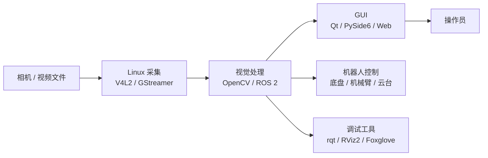

# 机器人 Linux 视觉与 GUI 指导手册

> 版本：v0.1（2026-11-18）  
> 对象：零基础，但需要最终在机器人上落地视觉画面与 GUI 的开发者  
> 维护规则：每次指导追加“课程记录”，包括目标、步骤、验收、排错、出处；不删除历史。

---

## 0. 这份文档怎么用

1. 先看本课 **目标** 和 **验收标准**，知道“做到什么算完成”。
2. 再按 **步骤** 复制命令执行；不要跳步。
3. 卡住时先看 **排错**，仍不行就把完整报错发到对话里。
4. 每课结束后，在文末“课程记录”追加日期和完成情况。

命令约定：

- `$` 开头表示普通用户执行。
- `#` 开头表示 root 执行，优先用 `sudo`。
- 所有命令都在 **WSL 的 Ubuntu 终端** 里执行，除非特别注明 PowerShell。

---

## 1. 最终目标与边界

我们要做的不是“先训练一个 AI 模型”，而是先打通一条可靠的工程链路：

```text
相机 / 视频源
   ↓
Linux 采集（V4L2 / GStreamer / ROS 2 驱动）
   ↓
视觉处理（OpenCV / ROS 2 节点）
   ↓
GUI（Qt/PySide6 或 Web）＋ 调试工具（rqt / RViz2 / Foxglove）
   ↓
机器人执行（底盘、机械臂、云台等）
```

### 三条路线，先选一条

| 路线 | 适合场景 | 优点 | 代价 |
|---|---|---|---|
| **Qt/PySide6 桌面 GUI** | 机器人自带触摸屏、单机操作 | 延迟低、部署简单、控件成熟 | 需要学 Qt 基础 |
| **Web GUI** | 手机/平板/远程浏览器访问 | 跨设备、易远程 | 视频延迟和网络配置更复杂 |
| **ROS 2 工具链** | 调试、算法开发 | rqt/RViz2/Foxglove 生态强 | 不是最终产品界面 |

**建议顺序：先 Qt 桌面 GUI，再 ROS 2 集成，最后按需做 Web。**  
理由：你现在的目标是“机器人上有一块能看的画面”，Qt 的路径最短，也最容易验证。

> 重要：WSL2 只用于开发和模拟。真正装在机器人上的系统应当是机器人本体的 Linux（Jetson、树莓派、x86 工控机）。不要把 WSL 当成机器人实时控制器。

---

## 2. 环境基线（2026-11-18 实测）

| 项目 | 实测结果 | 说明 |
|---|---|---|
| Windows | Windows 11，build 26200 | WSLg 可用 |
| WSL | 3.0.5.0，内核 6.18.58.1 | WSL2 |
| Linux | Ubuntu 24.04.5 LTS（noble） | 与 ROS 2 Jazzy 匹配 |
| 初始化系统 | systemd running | 可用 `systemctl` |
| GUI | WSLg 可用，`DISPLAY=:0`，Wayland 可用 | 能直接弹 Linux 窗口 |
| CPU | 16 vCPU | 足够 |
| 内存 | 6.7 GiB | 偏紧，暂不建议同时开 Gazebo + 大模型 |
| 磁盘 | 1007 GB，约 953 GB 可用 | 充足 |
| Python | 3.12.3，pip 24.0 | 系统 Python，不直接装包 |
| 科学计算 | numpy / cv2 / PySide6 / rclpy 均未安装 | 第 1 课安装 |
| ROS 2 | 未安装 | 第 3 课安装 |
| 摄像头 | WSL 内无 `/dev/video*` | 需要 USB 透传或网络相机 |
| 中文字体 | 未确认/可能缺失 | 第 1 课安装 Noto CJK |
| 网络 | GitHub、docs.ros.org 可访问（走代理） | 安装依赖可用 |

### 结论

- 这台机器**适合做视觉 + GUI 开发**。
- 内存 6.7 GiB 是主要瓶颈；第 1 课只装轻量依赖，不装 Gazebo。
- 摄像头还没进 WSL；第 2 课解决。第 1 课先用**生成测试图**验证 GUI，不依赖相机。

---

## 3. 总体架构：先建立正确心智模型



四个关键概念：

1. **采集**：Linux 通过 V4L2 读取 USB/CSI 相机；网络相机走 RTSP/GStreamer。
2. **处理**：OpenCV 做图像变换、检测、标定；ROS 2 负责模块间通信。
3. **显示**：Qt 把图像画到窗口/触摸屏；不是简单 `cv2.imshow` 就结束。
4. **部署**：机器人开机自动启动、全屏 kiosk、异常重启，这些是产品化必须做的事。

---

## 4. 权威资料库

> 原则：**官方文档 > 经典教材/论文 > 高赞视频**。视频用于入门，版本以官方文档为准。

### 4.1 官方文档（最高优先）

| 主题 | 链接 | 用途 |
|---|---|---|
| ROS 2 Jazzy | <https://docs.ros.org/en/jazzy/> | 总入口，先读 Tutorials |
| ROS 2 Jazzy Ubuntu 安装 | <https://docs.ros.org/en/jazzy/Installation/Ubuntu-Install-Debs.html> | 第 3 课照此安装 |
| OpenCV 4.x | <https://docs.opencv.org/4.x/> | 图像处理、相机标定 |
| Qt for Python | <https://doc.qt.io/qtforpython-6/> | PySide6 官方文档 |
| Foxglove | <https://docs.foxglove.dev/> | 机器人数据可视化 |
| WSL GUI | <https://learn.microsoft.com/en-us/windows/wsl/tutorials/gui-apps> | WSLg 原理与限制 |
| WSL USB | <https://learn.microsoft.com/en-us/windows/wsl/connect-usb> | 第 2 课摄像头透传 |

### 4.2 GitHub 仓库（star 数为 2026-11-18 通过 GitHub API 查询）

| 仓库 | Stars | 用途 |
|---|---:|---|
| [ros2/ros2](https://github.com/ros2/ros2) | 6,329 | ROS 2 核心 |
| [opencv/opencv](https://github.com/opencv/opencv) | 91,626 | 计算机视觉库 |
| [IntelRealSense/realsense-ros](https://github.com/IntelRealSense/realsense-ros) | 3,486 | RealSense 相机 ROS 2 驱动 |
| [ros-drivers/usb_cam](https://github.com/ros-drivers/usb_cam) | 726 | 普通 USB 相机 ROS 2 驱动 |
| [ros2/rviz](https://github.com/ros2/rviz) | 502 | ROS 2 3D 可视化 |

> 注意：Qt/PySide6 的主仓库不在 GitHub 镜像上，GitHub star 数不能代表 Qt 的权威性；Qt 以官方文档为准。Foxglove 的开源仓库状态几经变化，也不要用 star 数做判断。

### 4.3 论文与教材（建立理论底座）

1. **ROS 2 设计论文（必读）**  
   S. Macenski, T. Foote, B. Gerkey, C. Lalancette, W. Woodall,  
   “Robot Operating System 2: Design, architecture, and uses in the wild,”  
   *Science Robotics*, 7(66), eabm6074, 2022.  
   DOI: <https://doi.org/10.1126/scirobotics.abm6074>

2. **相机标定经典论文**  
   Z. Zhang, “A Flexible New Technique for Camera Calibration,”  
   *IEEE TPAMI*, 22(11): 1330–1334, 2000.  
   DOI: <https://doi.org/10.1109/34.888718>

3. **视觉伺服入门**  
   F. Chaumette, S. Hutchinson, “Visual Servo Control, Part I: Basic Approaches,”  
   *IEEE Robotics & Automation Magazine*, 13(4): 82–90, 2006.  
   DOI: <https://doi.org/10.1109/MRA.2006.250569>

4. **教材：Robotics, Vision and Control（Python 版）**  
   P. Corke, *Robotics, Vision and Control: Fundamental Algorithms in Python*, 3rd ed., Springer, 2023.  
   DOI: <https://doi.org/10.1007/978-3-031-06469-2>

5. **教材：Probabilistic Robotics（定位/SLAM 基础）**  
   S. Thrun, W. Burgard, D. Fox, *Probabilistic Robotics*, MIT Press, 2005.  
   <https://mitpress.mit.edu/9780262201629/probabilistic-robotics/>

### 4.4 B 站视频（人工筛选，作为入门辅助）

| 课程 | UP 主 | 数据（2026-11-18） | 链接 | 说明 |
|---|---|---|---|---|
| ROS2 入门 21 讲 | 古月居GYH | 119.9 万播放，4.39 万收藏，436 分钟 | <https://www.bilibili.com/video/BV16B4y1Q7jQ> | 中文 ROS 2 入门经典；版本可能早于 Jazzy，注意命令差异 |
| PySide6 百炼成真 | Python调包侠-Bemake | 36.5 万播放，1.57 万收藏，610 分钟 | <https://www.bilibili.com/video/BV1c84y1N7iL> | 系统学 Qt/PySide6，适合做上位机界面 |
| Qt 调用 OpenCV 处理图片 | — | 单集 | <https://www.bilibili.com/video/BV19kNezJEx7> | 只看“Qt 如何显示 OpenCV 图像”这一件事 |

> 视频只解决“怎么上手”，不替代官方文档。ROS 2 版本差异（Humble/Foxy → Jazzy）以 <https://docs.ros.org/en/jazzy/> 为准。

---

## 5. 课程路线与验收标准

| 阶段 | 主题 | 验收标准 | 预计 |
|---|---|---|---|
| **L0** | 环境、Git、文档 | 仓库可提交；环境基线清楚 | 本次 |
| **L1** | WSLg + Python + OpenCV + PySide6 | 弹出 Qt 窗口并显示测试图/摄像头画面 | 1 次 |
| **L2** | 相机接入与标定 | WSL 能读 `/dev/video0`；得到相机内参 | 1–2 次 |
| **L3** | ROS 2 Jazzy | `ros2 run` 能跑；`rqt_image_view` 能看到图像话题 | 2 次 |
| **L4** | Qt GUI 接入 ROS 2 | GUI 订阅 `/image_raw` 并显示，按钮能控制 | 2 次 |
| **L5** | 部署到机器人 | 开机自启、全屏、断线重连、性能达标 | 2–3 次 |

### 每课的固定结构

1. **目标**：一句话说明本课产出。
2. **前置**：需要先完成什么。
3. **步骤**：命令 + 解释，按顺序。
4. **验收**：看到什么算成功。
5. **排错**：常见错误与处理。
6. **出处**：官方文档/论文/视频链接。

---

## 6. 第 0 课：工作区修复与环境审计（2026-11-18）

### 6.1 目标

- 修复 DSH 无法写入 `D:\DSH\linux-gui` 的 Windows ACL 问题。
- 建立 Git 仓库、`指导.md`、`日志.md`。
- 记录真实环境，决定第 1 课的技术选型。

### 6.2 遇到的问题

DSH 启动文件沙箱时报错：

```text
SetNamedSecurityInfoW failed (Win32 5): grantWrite(D:\DSH\linux-gui)
```

含义：当前 Windows 账户没有修改该目录 ACL 的权限，DSH 无法给工作区加写权限。  
处理：以管理员身份执行 `takeown` + `icacls`，把所有权和完全控制权授予当前账户。修复后 DSH 可正常读写。

> 这是 Windows 权限问题，不是 Ubuntu、ROS 2 或摄像头的问题。

### 6.3 审计命令

在 WSL 中执行只读脚本（仓库内 `scripts/audit_wsl.sh`）：

```bash
wsl -d Ubuntu-24.04
bash /mnt/d/DSH/linux-gui/scripts/audit_wsl.sh
```

### 6.4 审计结论

- Ubuntu 24.04.5 + systemd + WSLg 正常，具备 GUI 开发条件。
- Python 3.12.3 可用，但没有任何视觉/GUI 包。
- 没有 ROS 2，没有 `/dev/video*`。
- 内存 6.7 GiB，先做轻量 GUI，不装 Gazebo。
- 网络可达 GitHub 与 ROS 文档。

### 6.5 出处

- WSL GUI 官方文档：<https://learn.microsoft.com/en-us/windows/wsl/tutorials/gui-apps>
- ROS 2 Jazzy 官方文档：<https://docs.ros.org/en/jazzy/>
- 本次实测输出见 `日志.md`。

### 6.6 GitHub 仓库

- 地址：<https://github.com/Stbxy/Linux-GUI>
- 当前可见性：public（由你创建）
- 本地 remote：`origin`
- 首次提交：`cac8b5d chore: bootstrap linux robot vision GUI learning repo`
- 推送命令：`git push -u origin main`

> 后续每次学习至少一个 commit；提交信息用 `lesson01: ...`、`docs: ...`。
>
> 公开仓库不要提交 token、密码、私钥或包含隐私的相机原图。

---

## 7. 第 1 课（待执行验证）：WSLg + Python 视觉 GUI 最小闭环

### 目标

在 WSL 里弹出一个 **PySide6 窗口**，显示一张由 OpenCV/NumPy 生成的测试图；再用同一个窗口显示摄像头画面（如果第 2 课已接通相机）。

### 技术选型

- **Python 3.12 + venv**：隔离系统包，避免 `pip install` 污染 Ubuntu。
- **opencv-python-headless**：只做图像处理，不依赖 OpenCV 自带 GUI。
- **PySide6**：Qt 官方 Python 绑定，负责窗口、按钮、图像显示。
- **numpy**：图像矩阵运算基础。

> 为什么不用 `cv2.imshow`？因为最终 GUI 要嵌入按钮、状态栏、触摸交互；Qt 才是产品级方案。`cv2.imshow` 只适合临时调试。

### 执行步骤（由你在 Ubuntu 终端执行）

> 按你的要求：**软件由你安装，我只给命令、解释和验收标准**。下面每一段都请在你自己的 Ubuntu 终端里执行；不要让我代装。
>
> 打开方式：Windows Terminal 下拉菜单选 **Ubuntu-24.04**，或按 `Win+R` 输入 `wsl -d Ubuntu-24.04`。提示符应是 `stbxy@...:~$`，不是 `PS C:\...>`。

#### 第 0 步：确认 WSLg 正常

```bash
lsb_release -ds
python3 --version
echo "DISPLAY=$DISPLAY"
echo "WAYLAND_DISPLAY=$WAYLAND_DISPLAY"
```

期望：

- `Ubuntu 24.04.x LTS`
- `Python 3.12.x`
- `DISPLAY=:0`（或 `:1`）
- `WAYLAND_DISPLAY=wayland-0`

如果 `DISPLAY` 为空，先不要装 Python 包，把输出发我，先修 WSLg。

#### 第 1 步：安装 Qt 运行所需的系统库（需要 Ubuntu 密码）

```bash
sudo apt update
sudo apt install -y \
  fonts-noto-cjk v4l-utils \
  libgl1 libglib2.0-0 \
  libxcb-cursor0 libxcb-icccm4 libxcb-image0 libxcb-keysyms1 \
  libxcb-randr0 libxcb-render-util0 libxcb-shape0 libxcb-xinerama0 \
  libxcb-xkb1 libxkbcommon-x11-0 libdbus-1-3 libfontconfig1
```

这些包分别做什么：

| 包 | 作用 |
|---|---|
| `fonts-noto-cjk` | 中文显示，避免界面出现方块 |
| `v4l-utils` | 第 2 课查看/调试 `/dev/video0` |
| `libgl1`、`libglib2.0-0` | OpenGL/GLib 基础运行库 |
| `libxcb-*` | Qt 的 xcb 窗口平台插件依赖；缺一个就可能报 “Could not load the Qt platform plugin xcb” |
| `libxkbcommon-x11-0` | 键盘输入 |
| `libdbus-1-3` | Qt 的 D-Bus 支持 |
| `libfontconfig1` | 字体查找 |

> 这里用 `sudo` 是正常的：安装系统库必须 root。后面的 `pip install` **绝对不要加 sudo**。

#### 第 2 步：确认 Python 虚拟环境

我们已经在 `/home/stbxy/robot-venv` 创建了空环境（还没装任何视觉/GUI 包）。检查：

```bash
test -x ~/robot-venv/bin/python && echo "venv OK" || echo "venv MISSING"
```

如果输出 `venv OK`，直接进入第 3 步。

如果输出 `venv MISSING`：

```bash
sudo apt install -y python3-venv
python3 -m venv ~/robot-venv
```

然后激活并确认：

```bash
source ~/robot-venv/bin/activate
which python
python -V
```

`which python` 应指向 `/home/stbxy/robot-venv/bin/python`。

#### 第 3 步：安装 Python 包（不要 sudo）

```bash
source ~/robot-venv/bin/activate
python -m pip install --upgrade pip wheel
python -m pip install "numpy<3" opencv-python-headless PySide6
```

说明：

- `numpy<3`：图像矩阵基础库，限制大版本避免和 OpenCV wheel 冲突。
- `opencv-python-headless`：只装 OpenCV 的图像处理/视频采集，不装它自带的 GUI（我们用 Qt 显示）。
- `PySide6`：Qt 官方 Python 绑定，负责窗口和控件。
- 下载量大约几百 MB，第一次安装可能需要几分钟；不要中途 Ctrl+C。

#### 第 4 步：验证三个包

```bash
python - <<'PY'
import numpy, cv2, PySide6
print("numpy  ", numpy.__version__)
print("opencv ", cv2.__version__)
print("PySide6", PySide6.__version__)
PY
```

把这三行版本号发我，确认安装成功。

#### 第 5 步：运行第 1 课

```bash
cd /mnt/d/DSH/linux-gui
python lessons/01_gui_test/main.py
```

预期：Windows 桌面上弹出一个 Linux 窗口，显示彩色渐变、移动的白色圆、左上角标题、左下角 FPS。点击“打开摄像头”时，如果没有 `/dev/video0`，应提示并继续显示测试图，不崩溃。

### 验收

- 执行 `python lessons/01_gui_test/main.py` 后，Windows 桌面上出现一个 Linux GUI 窗口。
- 窗口里能看到测试图（彩色渐变 + 文字 + 帧率）。
- 关闭窗口后进程正常退出，无报错。

### 出处

- Qt for Python 官方文档：<https://doc.qt.io/qtforpython-6/>
- OpenCV Python 教程：<https://docs.opencv.org/4.x/d6/d00/tutorial_py_root.html>
- WSLg：<https://learn.microsoft.com/en-us/windows/wsl/tutorials/gui-apps>

---

## 8. 术语表（持续补充）

| 术语 | 解释 |
|---|---|
| WSL2 | Windows Subsystem for Linux 2，在 Windows 上跑真实 Linux 内核 |
| WSLg | WSL 的 GUI 支持，让 Linux 窗口直接显示在 Windows 桌面 |
| V4L2 | Linux 视频采集接口，USB 相机通常走它 |
| ROS 2 | 机器人操作系统 2，节点间通过 topic/service/action 通信 |
| node | ROS 2 中的一个进程/模块 |
| topic | 节点间发布/订阅的数据通道，图像常用 `sensor_msgs/msg/Image` |
| `cv_bridge` | ROS 图像消息与 OpenCV 图像之间的转换桥 |
| Qt / PySide6 | 跨平台 GUI 框架 / 其官方 Python 绑定 |
| kiosk | 开机全屏、锁定界面的展示模式 |
| usbipd-win | 把 Windows 的 USB 设备透传给 WSL 的工具 |

---

## 9. 安全与工程规范

1. **不要在系统 Python 里 `pip install`**：一律用 venv。
2. **不要用 root 跑 GUI/ROS 节点**：权限过大，容易误操作。
3. **相机标定文件要进 Git**：否则换机器后无法复现。
4. **日志与指导文档同步提交**：每次学习至少一个 commit。
5. **部署前先做断网/断电测试**：机器人不是笔记本，异常恢复很重要。
6. **Qt 许可证**：PySide6 是 LGPLv3/GPLv3/商业许可；如果将来卖产品，先确认动态链接和许可证义务。

---

## 课程记录

### 2026-11-18 · 第 0 课

- 完成：工作区 ACL 修复、环境审计、Git 仓库初始化、文档建立。
- GitHub：已确认 <https://github.com/Stbxy/Linux-GUI>，推送 `main`，首次提交 `cac8b5d`。
- 第 1 课：代码（`lessons/01_gui_test/main.py`）与安装步骤已就绪；待你在 Ubuntu 终端安装依赖并运行。
- 未完成：L1 运行验证；相机接入；ROS 2 安装。
- 下一课：L1 验收，然后把摄像头接进 WSL。
