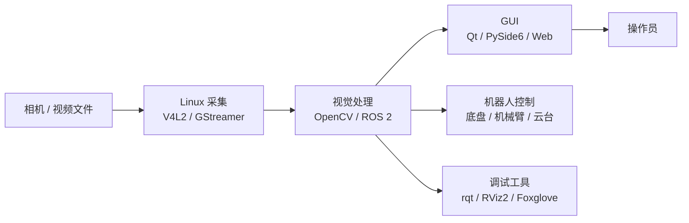

# 机器人 Linux 视觉与 GUI 指导手册

> 版本：v0.1（2026-11-18）  
> 对象：零基础，但需要最终在机器人上落地视觉画面与 GUI 的开发者  
> 维护规则：每次指导追加“课程记录”，包括目标、步骤、验收、排错、出处；不删除历史。

---

## 0. 这份文档怎么用

1. 先看本课 **目标** 和 **验收标准**，知道“做到什么算完成”。
2. 再按 **步骤** 复制命令执行；不要跳步。
3. 卡住时先看 **排错**，仍不行就把完整报错发到对话里。
4. 每课结束后，在文末“课程记录”追加日期和完成情况。

命令约定：

- `$` 开头表示普通用户执行。
- `#` 开头表示 root 执行，优先用 `sudo`。
- 所有命令都在 **WSL 的 Ubuntu 终端** 里执行，除非特别注明 PowerShell。

---

## 1. 最终目标与边界

我们要做的不是“先训练一个 AI 模型”，而是先打通一条可靠的工程链路：

```text
相机 / 视频源
   ↓
Linux 采集（V4L2 / GStreamer / ROS 2 驱动）
   ↓
视觉处理（OpenCV / ROS 2 节点）
   ↓
GUI（Qt/PySide6 或 Web）＋ 调试工具（rqt / RViz2 / Foxglove）
   ↓
机器人执行（底盘、机械臂、云台等）
```

### 三条路线，先选一条

| 路线 | 适合场景 | 优点 | 代价 |
|---|---|---|---|
| **Qt/PySide6 桌面 GUI** | 机器人自带触摸屏、单机操作 | 延迟低、部署简单、控件成熟 | 需要学 Qt 基础 |
| **Web GUI** | 手机/平板/远程浏览器访问 | 跨设备、易远程 | 视频延迟和网络配置更复杂 |
| **ROS 2 工具链** | 调试、算法开发 | rqt/RViz2/Foxglove 生态强 | 不是最终产品界面 |

**建议顺序：先 Qt 桌面 GUI，再 ROS 2 集成，最后按需做 Web。**  
理由：你现在的目标是“机器人上有一块能看的画面”，Qt 的路径最短，也最容易验证。

> 重要：WSL2 只用于开发和模拟。真正装在机器人上的系统应当是机器人本体的 Linux（Jetson、树莓派、x86 工控机）。不要把 WSL 当成机器人实时控制器。

---

## 2. 环境基线（2026-11-18 实测）

| 项目 | 实测结果 | 说明 |
|---|---|---|
| Windows | Windows 11，build 26200 | WSLg 可用 |
| WSL | 3.0.5.0，内核 6.18.58.1 | WSL2 |
| Linux | Ubuntu 24.04.5 LTS（noble） | 与 ROS 2 Jazzy 匹配 |
| 初始化系统 | systemd running | 可用 `systemctl` |
| GUI | WSLg 可用，`DISPLAY=:0`，Wayland 可用 | 能直接弹 Linux 窗口 |
| CPU | 16 vCPU | 足够 |
| 内存 | 6.7 GiB | 偏紧，暂不建议同时开 Gazebo + 大模型 |
| 磁盘 | 1007 GB，约 953 GB 可用 | 充足 |
| Python | 3.12.3，pip 24.0 | 系统 Python，不直接装包 |
| 科学计算 | numpy / cv2 / PySide6 / rclpy 均未安装 | 第 1 课安装 |
| ROS 2 | 未安装 | 第 3 课安装 |
| 摄像头 | WSL 内无 `/dev/video*` | 需要 USB 透传或网络相机 |
| 中文字体 | 未确认/可能缺失 | 第 1 课安装 Noto CJK |
| 网络 | GitHub、docs.ros.org 可访问（走代理） | 安装依赖可用 |

### 结论

- 这台机器**适合做视觉 + GUI 开发**。
- 内存 6.7 GiB 是主要瓶颈；第 1 课只装轻量依赖，不装 Gazebo。
- 摄像头还没进 WSL；第 2 课解决。第 1 课先用**生成测试图**验证 GUI，不依赖相机。

---

## 3. 总体架构：先建立正确心智模型



四个关键概念：

1. **采集**：Linux 通过 V4L2 读取 USB/CSI 相机；网络相机走 RTSP/GStreamer。
2. **处理**：OpenCV 做图像变换、检测、标定；ROS 2 负责模块间通信。
3. **显示**：Qt 把图像画到窗口/触摸屏；不是简单 `cv2.imshow` 就结束。
4. **部署**：机器人开机自动启动、全屏 kiosk、异常重启，这些是产品化必须做的事。

---

## 4. 权威资料库

> 原则：**官方文档 > 经典教材/论文 > 高赞视频**。视频用于入门，版本以官方文档为准。

### 4.1 官方文档（最高优先）

| 主题 | 链接 | 用途 |
|---|---|---|
| ROS 2 Jazzy | <https://docs.ros.org/en/jazzy/> | 总入口，先读 Tutorials |
| ROS 2 Jazzy Ubuntu 安装 | <https://docs.ros.org/en/jazzy/Installation/Ubuntu-Install-Debs.html> | 第 3 课照此安装 |
| OpenCV 4.x | <https://docs.opencv.org/4.x/> | 图像处理、相机标定 |
| Qt for Python | <https://doc.qt.io/qtforpython-6/> | PySide6 官方文档 |
| Foxglove | <https://docs.foxglove.dev/> | 机器人数据可视化 |
| WSL GUI | <https://learn.microsoft.com/en-us/windows/wsl/tutorials/gui-apps> | WSLg 原理与限制 |
| WSL USB | <https://learn.microsoft.com/en-us/windows/wsl/connect-usb> | 第 2 课摄像头透传 |

### 4.2 GitHub 仓库（star 数为 2026-11-18 通过 GitHub API 查询）

| 仓库 | Stars | 用途 |
|---|---:|---|
| [ros2/ros2](https://github.com/ros2/ros2) | 6,329 | ROS 2 核心 |
| [opencv/opencv](https://github.com/opencv/opencv) | 91,626 | 计算机视觉库 |
| [IntelRealSense/realsense-ros](https://github.com/IntelRealSense/realsense-ros) | 3,486 | RealSense 相机 ROS 2 驱动 |
| [ros-drivers/usb_cam](https://github.com/ros-drivers/usb_cam) | 726 | 普通 USB 相机 ROS 2 驱动 |
| [ros2/rviz](https://github.com/ros2/rviz) | 502 | ROS 2 3D 可视化 |

> 注意：Qt/PySide6 的主仓库不在 GitHub 镜像上，GitHub star 数不能代表 Qt 的权威性；Qt 以官方文档为准。Foxglove 的开源仓库状态几经变化，也不要用 star 数做判断。

### 4.3 论文与教材（建立理论底座）

1. **ROS 2 设计论文（必读）**  
   S. Macenski, T. Foote, B. Gerkey, C. Lalancette, W. Woodall,  
   “Robot Operating System 2: Design, architecture, and uses in the wild,”  
   *Science Robotics*, 7(66), eabm6074, 2022.  
   DOI: <https://doi.org/10.1126/scirobotics.abm6074>

2. **相机标定经典论文**  
   Z. Zhang, “A Flexible New Technique for Camera Calibration,”  
   *IEEE TPAMI*, 22(11): 1330–1334, 2000.  
   DOI: <https://doi.org/10.1109/34.888718>

3. **视觉伺服入门**  
   F. Chaumette, S. Hutchinson, “Visual Servo Control, Part I: Basic Approaches,”  
   *IEEE Robotics & Automation Magazine*, 13(4): 82–90, 2006.  
   DOI: <https://doi.org/10.1109/MRA.2006.250569>

4. **教材：Robotics, Vision and Control（Python 版）**  
   P. Corke, *Robotics, Vision and Control: Fundamental Algorithms in Python*, 3rd ed., Springer, 2023.  
   DOI: <https://doi.org/10.1007/978-3-031-06469-2>

5. **教材：Probabilistic Robotics（定位/SLAM 基础）**  
   S. Thrun, W. Burgard, D. Fox, *Probabilistic Robotics*, MIT Press, 2005.  
   <https://mitpress.mit.edu/9780262201629/probabilistic-robotics/>

### 4.4 B 站视频（人工筛选，作为入门辅助）

| 课程 | UP 主 | 数据（2026-11-18） | 链接 | 说明 |
|---|---|---|---|---|
| ROS2 入门 21 讲 | 古月居GYH | 119.9 万播放，4.39 万收藏，436 分钟 | <https://www.bilibili.com/video/BV16B4y1Q7jQ> | 中文 ROS 2 入门经典；版本可能早于 Jazzy，注意命令差异 |
| PySide6 百炼成真 | Python调包侠-Bemake | 36.5 万播放，1.57 万收藏，610 分钟 | <https://www.bilibili.com/video/BV1c84y1N7iL> | 系统学 Qt/PySide6，适合做上位机界面 |
| Qt 调用 OpenCV 处理图片 | — | 单集 | <https://www.bilibili.com/video/BV19kNezJEx7> | 只看“Qt 如何显示 OpenCV 图像”这一件事 |

> 视频只解决“怎么上手”，不替代官方文档。ROS 2 版本差异（Humble/Foxy → Jazzy）以 <https://docs.ros.org/en/jazzy/> 为准。

---

## 5. 课程路线与验收标准

| 阶段 | 主题 | 验收标准 | 预计 |
|---|---|---|---|
| **L0** | 环境、Git、文档 | 仓库可提交；环境基线清楚 | 本次 |
| **L1** | WSLg + Python + OpenCV + PySide6 | 弹出 Qt 窗口并显示测试图/摄像头画面 | 1 次 |
| **L2** | 相机接入与标定 | WSL 能读 `/dev/video0`；得到相机内参 | 1–2 次 |
| **L3** | ROS 2 Jazzy | `ros2 run` 能跑；`rqt_image_view` 能看到图像话题 | 2 次 |
| **L4** | Qt GUI 接入 ROS 2 | GUI 订阅 `/image_raw` 并显示，按钮能控制 | 2 次 |
| **L5** | 部署到机器人 | 开机自启、全屏、断线重连、性能达标 | 2–3 次 |

### 每课的固定结构

1. **目标**：一句话说明本课产出。
2. **前置**：需要先完成什么。
3. **步骤**：命令 + 解释，按顺序。
4. **验收**：看到什么算成功。
5. **排错**：常见错误与处理。
6. **出处**：官方文档/论文/视频链接。

---

## 6. 第 0 课：工作区修复与环境审计（2026-11-18）

### 6.1 目标

- 修复 DSH 无法写入 `D:\DSH\linux-gui` 的 Windows ACL 问题。
- 建立 Git 仓库、`指导.md`、`日志.md`。
- 记录真实环境，决定第 1 课的技术选型。

### 6.2 遇到的问题

DSH 启动文件沙箱时报错：

```text
SetNamedSecurityInfoW failed (Win32 5): grantWrite(D:\DSH\linux-gui)
```

含义：当前 Windows 账户没有修改该目录 ACL 的权限，DSH 无法给工作区加写权限。  
处理：以管理员身份执行 `takeown` + `icacls`，把所有权和完全控制权授予当前账户。修复后 DSH 可正常读写。

> 这是 Windows 权限问题，不是 Ubuntu、ROS 2 或摄像头的问题。

### 6.3 审计命令

在 WSL 中执行只读脚本（仓库内 `scripts/audit_wsl.sh`）：

```bash
wsl -d Ubuntu-24.04
bash /mnt/d/DSH/linux-gui/scripts/audit_wsl.sh
```

### 6.4 审计结论

- Ubuntu 24.04.5 + systemd + WSLg 正常，具备 GUI 开发条件。
- Python 3.12.3 可用，但没有任何视觉/GUI 包。
- 没有 ROS 2，没有 `/dev/video*`。
- 内存 6.7 GiB，先做轻量 GUI，不装 Gazebo。
- 网络可达 GitHub 与 ROS 文档。

### 6.5 出处

- WSL GUI 官方文档：<https://learn.microsoft.com/en-us/windows/wsl/tutorials/gui-apps>
- ROS 2 Jazzy 官方文档：<https://docs.ros.org/en/jazzy/>
- 本次实测输出见 `日志.md`。

### 6.6 GitHub 仓库

- 地址：<https://github.com/Stbxy/Linux-GUI>
- 当前可见性：public（由你创建）
- 本地 remote：`origin`
- 首次提交：`cac8b5d chore: bootstrap linux robot vision GUI learning repo`
- 推送命令：`git push -u origin main`

> 后续每次学习至少一个 commit；提交信息用 `lesson01: ...`、`docs: ...`。
>
> 公开仓库不要提交 token、密码、私钥或包含隐私的相机原图。

---

## 7. 第 1 课（待执行验证）：WSLg + Python 视觉 GUI 最小闭环

### 目标

在 WSL 里弹出一个 **PySide6 窗口**，显示一张由 OpenCV/NumPy 生成的测试图；再用同一个窗口显示摄像头画面（如果第 2 课已接通相机）。

### 技术选型

- **Python 3.12 + venv**：隔离系统包，避免 `pip install` 污染 Ubuntu。
- **opencv-python-headless**：只做图像处理，不依赖 OpenCV 自带 GUI。
- **PySide6**：Qt 官方 Python 绑定，负责窗口、按钮、图像显示。
- **numpy**：图像矩阵运算基础。

> 为什么不用 `cv2.imshow`？因为最终 GUI 要嵌入按钮、状态栏、触摸交互；Qt 才是产品级方案。`cv2.imshow` 只适合临时调试。

### 执行步骤（由你在 Ubuntu 终端执行）

> 按你的要求：**软件由你安装，我只给命令、解释和验收标准**。下面每一段都请在你自己的 Ubuntu 终端里执行；不要让我代装。
>
> 打开方式：Windows Terminal 下拉菜单选 **Ubuntu-24.04**，或按 `Win+R` 输入 `wsl -d Ubuntu-24.04`。提示符应是 `stbxy@...:~$`，不是 `PS C:\...>`。
>
> **键盘没有 `~` 键？** 下面所有 `~/...` 都可以写成 `"$HOME/..."`，效果一样；详见 7.9。

#### 第 0 步：确认 WSLg 正常

```bash
lsb_release -ds
python3 --version
echo "DISPLAY=$DISPLAY"
echo "WAYLAND_DISPLAY=$WAYLAND_DISPLAY"
```

期望：

- `Ubuntu 24.04.x LTS`
- `Python 3.12.x`
- `DISPLAY=:0`（或 `:1`）
- `WAYLAND_DISPLAY=wayland-0`

如果 `DISPLAY` 为空，先不要装 Python 包，把输出发我，先修 WSLg。

#### 第 1 步：安装 Qt 运行所需的系统库（需要 Ubuntu 密码）

```bash
sudo apt update
sudo apt install -y \
  fonts-noto-cjk v4l-utils \
  libgl1 libglib2.0-0 \
  libxcb-cursor0 libxcb-icccm4 libxcb-image0 libxcb-keysyms1 \
  libxcb-randr0 libxcb-render-util0 libxcb-shape0 libxcb-xinerama0 \
  libxcb-xkb1 libxkbcommon-x11-0 libdbus-1-3 libfontconfig1
```

这些包分别做什么：

| 包 | 作用 |
|---|---|
| `fonts-noto-cjk` | 中文显示，避免界面出现方块 |
| `v4l-utils` | 第 2 课查看/调试 `/dev/video0` |
| `libgl1`、`libglib2.0-0` | OpenGL/GLib 基础运行库 |
| `libxcb-*` | Qt 的 xcb 窗口平台插件依赖；缺一个就可能报 “Could not load the Qt platform plugin xcb” |
| `libxkbcommon-x11-0` | 键盘输入 |
| `libdbus-1-3` | Qt 的 D-Bus 支持 |
| `libfontconfig1` | 字体查找 |

> 这里用 `sudo` 是正常的：安装系统库必须 root。后面的 `pip install` **绝对不要加 sudo**。

#### 第 2 步：确认 Python 虚拟环境

我们已经在 `/home/stbxy/robot-venv` 创建了空环境（还没装任何视觉/GUI 包）。检查：

```bash
test -x ~/robot-venv/bin/python && echo "venv OK" || echo "venv MISSING"
```

如果输出 `venv OK`，直接进入第 3 步。

如果输出 `venv MISSING`：

```bash
sudo apt install -y python3-venv
python3 -m venv ~/robot-venv
```

然后激活并确认：

```bash
source ~/robot-venv/bin/activate
which python
python -V
```

`which python` 应指向 `/home/stbxy/robot-venv/bin/python`。

#### 第 3 步：安装 Python 包（不要 sudo）

```bash
source ~/robot-venv/bin/activate
python -m pip install --upgrade pip wheel
python -m pip install "numpy<3" opencv-python-headless PySide6
```

说明：

- `numpy<3`：图像矩阵基础库，限制大版本避免和 OpenCV wheel 冲突。
- `opencv-python-headless`：只装 OpenCV 的图像处理/视频采集，不装它自带的 GUI（我们用 Qt 显示）。
- `PySide6`：Qt 官方 Python 绑定，负责窗口和控件。
- 下载量大约几百 MB，第一次安装可能需要几分钟；不要中途 Ctrl+C。

#### 第 4 步：验证三个包

```bash
python - <<'PY'
import numpy, cv2, PySide6
print("numpy  ", numpy.__version__)
print("opencv ", cv2.__version__)
print("PySide6", PySide6.__version__)
PY
```

把这三行版本号发我，确认安装成功。

#### 第 5 步：运行第 1 课

```bash
cd /mnt/d/DSH/linux-gui
python lessons/01_gui_test/main.py
```

预期：Windows 桌面上弹出一个 Linux 窗口，显示彩色渐变、移动的白色圆、左上角标题、左下角 FPS。点击“打开摄像头”时，如果没有 `/dev/video0`，应提示并继续显示测试图，不崩溃。

### 验收

- 执行 `python lessons/01_gui_test/main.py` 后，Windows 桌面上出现一个 Linux GUI 窗口。
- 窗口里能看到测试图（彩色渐变 + 文字 + 帧率）。
- 关闭窗口后进程正常退出，无报错。

### 出处

- Qt for Python 官方文档：<https://doc.qt.io/qtforpython-6/>
- OpenCV Python 教程：<https://docs.opencv.org/4.x/d6/d00/tutorial_py_root.html>
- WSLg：<https://learn.microsoft.com/en-us/windows/wsl/tutorials/gui-apps>

---

### 7.6 命令逐条解释（零基础）

> 这一节解释第 1 课里出现的每一条命令。先看 7.6.0 的五个规则，再对照上面的步骤读。

#### 7.6.0 先学会读命令

终端提示符一般长这样：

~~~text
stbxy@DESKTOP-XXX:~$
~~~

拆开看：

- `stbxy`：当前 Linux 用户名。
- `DESKTOP-XXX`：主机名。
- `~`：当前目录是家目录，也就是 `/home/stbxy`。
- `$`：普通用户提示符；如果是 `#`，表示当前是 root。

一条命令的结构：

~~~text
sudo apt install -y fonts-noto-cjk
└─┬─┘ └┬┘ └──┬──┘ └┬┘ └──────┬──────┘
  │    │      │      │         └─ 参数：要安装的包
  │    │      │      └─ 选项：自动回答 yes
  │    │      └─ 子命令：安装
  │    └─ 程序：apt 包管理器
  └─ 以 root 权限运行
~~~

五个基本规则：

1. **空格分隔命令、选项、参数。** `sudo apt install` 是三个部分，不是一条单词。
2. **Linux 区分大小写。** `Python` 和 `python` 不是一回事；包名也一样。
3. **短选项用 `-`，长选项用 `--`。** 例如 `-V` 和 `--version` 通常等价；`-y` 表示 yes。
4. **路径决定操作对象。** `/` 是根目录，`~` 是家目录，`/mnt/d` 是 WSL 里看到的 Windows D 盘。
5. **命令有“退出码”。** `0` 表示成功，非 `0` 表示失败；`&&` 和 `||` 就是根据退出码决定下一步。

常见符号速记：

- `~`：家目录，`/home/stbxy`。
- `$DISPLAY`：环境变量，前面加 `$` 表示取它的值。
- `&&`：前一条成功才执行后一条。
- `||`：前一条失败才执行后一条。
- `|`：管道，把前一条的输出交给后一条处理。
- `>`：把输出写入文件（覆盖）。
- `<`：把文件内容作为输入。
- `\`：命令太长时换行；必须是行尾最后一个字符。
- `#`：注释，或者 root 提示符，看上下文。

---

#### 7.6.1 第 0 步：确认环境

**1. `lsb_release -ds`**

~~~bash
lsb_release -ds
~~~

- `lsb_release`：读取 Linux 发行版信息（LSB = Linux Standard Base）。
- `-d`：显示描述（distribution description）。
- `-s`：短格式，不打印字段名。
- 合起来就是一行：`Ubuntu 24.04.5 LTS`。
- 它只“读信息”，不改系统。

**2. `python3 --version`**

~~~bash
python3 --version
~~~

- `python3`：调用系统里的 Python 3 解释器。
- `--version`：长选项，打印版本号后退出。
- Ubuntu 24.04 默认只有 `python3`，不一定有 `python`；`python` 通常是 venv 激活后才出现。

**3. `echo "DISPLAY=$DISPLAY"`**

~~~bash
echo "DISPLAY=$DISPLAY"
~~~

- `echo`：把后面的内容打印到终端。
- 双引号里的 `$DISPLAY` 会被 shell **展开**成变量的值。
- `DISPLAY` 是 GUI 程序要找的“显示器地址”；WSLg 一般设为 `:0`。
- 如果输出 `DISPLAY=`（等号后面为空），说明 GUI 环境没准备好。

**4. `echo "WAYLAND_DISPLAY=$WAYLAND_DISPLAY"`**

~~~bash
echo "WAYLAND_DISPLAY=$WAYLAND_DISPLAY"
~~~

- `WAYLAND_DISPLAY` 是 Wayland 的显示套接字名称，通常是 `wayland-0`。
- WSLg 同时支持 X11 和 Wayland；这两个变量有一个正常，GUI 通常就能用。
- 这条命令同样只是“查看”，不修改任何东西。

---

#### 7.6.2 第 1 步：安装系统库

**1. `sudo apt update`**

~~~bash
sudo apt update
~~~

- `sudo`：superuser do，用 root 权限执行这一条命令；会要求输入你的 Ubuntu 密码。
- 输入密码时屏幕不显示任何字符，这是正常的，输完按回车。
- `apt`：Ubuntu 的包管理器，相当于 Linux 的“应用商店”。
- `update`：刷新“可安装软件清单”，从 Ubuntu 软件源下载最新的包索引。
- 它**不会**升级已安装的软件，也**不会**安装新软件；只是让后面的 `apt install` 知道有哪些包、什么版本。

**2. `sudo apt install -y \ ...`**

~~~bash
sudo apt install -y \
  fonts-noto-cjk v4l-utils \
  libgl1 libglib2.0-0 \
  libxcb-cursor0 libxcb-icccm4 libxcb-image0 libxcb-keysyms1 \
  libxcb-randr0 libxcb-render-util0 libxcb-shape0 libxcb-xinerama0 \
  libxcb-xkb1 libxkbcommon-x11-0 libdbus-1-3 libfontconfig1
~~~

- `sudo`：安装系统库要写 `/usr`、`/var/lib/apt` 等目录，必须 root。
- `apt install`：安装后面列出的包；apt 会自动处理依赖。
- `-y`：对所有“是否继续”的提问自动回答 yes。
- 行尾的 `\`：**续行符**，把多行合并成一条命令；它必须是该行最后一个字符，后面不能有空格。
- 包名之间用空格分隔，不是逗号。
- 这些包分三类：
  - `fonts-noto-cjk`：中文字体。
  - `v4l-utils`：摄像头调试工具，第 2 课用。
  - `libgl1`、`libglib2.0-0`、`libxcb-*`、`libxkbcommon-x11-0`、`libdbus-1-3`、`libfontconfig1`：Qt 运行所需的系统 `.so` 库。
- PySide6 的 wheel 自带 Qt，但**不会自带这些系统库**；缺了就会报 xcb 插件加载失败。

---

#### 7.6.3 第 2 步：Python 虚拟环境

**1. `test -x ~/robot-venv/bin/python && echo "venv OK" || echo "venv MISSING"`**

~~~bash
test -x ~/robot-venv/bin/python && echo "venv OK" || echo "venv MISSING"
~~~

拆开看：

- `test`：判断一个条件是否成立，本身不打印结果，只用退出码表示真假。
- `-x`：判断“文件存在并且有可执行权限”。
- `~/robot-venv/bin/python`：要检查的文件；`~` 会展开成 `/home/stbxy`。
- `&&`：如果 `test` 成功（退出码 0），执行后面的 `echo "venv OK"`。
- `||`：如果前面的整体失败，执行 `echo "venv MISSING"`。
- `echo`：打印文字。

所以这一行的意思是：**如果 venv 里的 Python 存在且可执行，打印 venv OK；否则打印 venv MISSING。**

**2. `sudo apt install -y python3-venv`**

~~~bash
sudo apt install -y python3-venv
~~~

- Ubuntu 把 `venv` 模块拆成了单独的包；不装它，`python3 -m venv` 会报错。
- `-y` 同样是自动确认。
- 这条只在 venv 缺失时执行。

**3. `python3 -m venv ~/robot-venv`**

~~~bash
python3 -m venv ~/robot-venv
~~~

- `python3`：用系统 Python 3 来创建环境。
- `-m venv`：运行 Python 标准库里的 `venv` 模块。
- `~/robot-venv`：新环境的存放位置，最终会有：
  - `bin/python`：这个环境自己的 Python。
  - `bin/pip`：这个环境自己的 pip。
  - `lib/python3.12/site-packages/`：以后安装的包放这里。
  - `pyvenv.cfg`：环境配置。
- 它只创建“空环境”，**不会**安装 numpy、OpenCV、PySide6。

**4. `source ~/robot-venv/bin/activate`**

~~~bash
source ~/robot-venv/bin/activate
~~~

- `source`：在**当前 shell** 里执行脚本，而不是开一个子 shell。
- `activate`：把 venv 的 `bin` 目录放到 `PATH` 最前面，并设置 `VIRTUAL_ENV`。
- 效果：以后输入 `python`、`pip`，用的都是 venv 里的版本；提示符前面出现 `(robot-venv)`。
- 激活只对**当前终端窗口**有效；新开一个终端要重新执行。
- 退出环境用 `deactivate`。

**5. `which python`**

~~~bash
which python
~~~

- `which`：按 `PATH` 的顺序查找命令，打印它找到的第一个完整路径。
- 期望输出 `/home/stbxy/robot-venv/bin/python`。
- 如果输出 `/usr/bin/python`，说明 venv 没激活成功。

**6. `python -V`**

~~~bash
python -V
~~~

- `-V` 是 `--version` 的短写法，打印 Python 版本。
- 这里的 `python` 已经是 venv 里的 Python；应该显示 `Python 3.12.x`。

---

#### 7.6.4 第 3 步：安装 Python 包

**1. `python -m pip install --upgrade pip wheel`**

~~~bash
python -m pip install --upgrade pip wheel
~~~

- `python -m pip`：用当前这个 Python 去运行 `pip` 模块，确保 pip 属于 venv，而不是系统。
- `install`：pip 的子命令，表示安装。
- `--upgrade`：如果已经安装，就升级到较新版本；这里只升级 `pip` 和 `wheel`。
- `pip`：Python 包安装器。
- `wheel`：打包工具，很多包用 `.whl` 格式分发。
- 这条命令**不要加 sudo**；它只写 `/home/stbxy/robot-venv`。

**2. `python -m pip install "numpy<3" opencv-python-headless PySide6`**

~~~bash
python -m pip install "numpy<3" opencv-python-headless PySide6
~~~

- `python -m pip install`：把后面的包安装到当前 venv。
- `numpy<3`：包名 `numpy`，版本要求“小于 3”。外面的引号是给 shell 看的，防止 `<` 被当成输入重定向。
- `opencv-python-headless`：OpenCV 的 Python 包，headless 表示不带 OpenCV 自带 GUI；图像采集和处理仍然可用。
- `PySide6`：Qt 的 Python 绑定，提供窗口、按钮、图像显示。
- pip 会从 PyPI 下载预编译的 `.whl`，解压到 `site-packages`；一般不需要编译器。
- 仍然**不要加 sudo**。

---

#### 7.6.5 第 4 步：验证安装

**`python - <<'PY' ... PY`**

~~~bash
python - <<'PY'
import numpy, cv2, PySide6
print("numpy  ", numpy.__version__)
print("opencv ", cv2.__version__)
print("PySide6", PySide6.__version__)
PY
~~~

- `python -`：让 Python 从**标准输入**读取代码，而不是从文件读取。
- `<<'PY'`：here-document，把下面直到单独一行 `PY` 的内容，作为标准输入喂给 Python。
- 引号包住 `'PY'`：阻止 shell 展开里面的 `$变量`；这里没有变量，但这是好习惯。
- `import numpy, cv2, PySide6`：导入三个模块；OpenCV 的模块名是 `cv2`，不是 `opencv`。
- `__version__`：模块自带的版本字符串。
- 如果某个包没装好，这里会报 `ModuleNotFoundError`，一眼就能定位。

---

#### 7.6.6 第 5 步：运行程序

**1. `cd /mnt/d/DSH/linux-gui`**

~~~bash
cd /mnt/d/DSH/linux-gui
~~~

- `cd`：change directory，切换当前目录。
- `/mnt/d`：WSL 自动挂载的 Windows D 盘；`/mnt/d/DSH/linux-gui` 对应 Windows 的 `D:\DSH\linux-gui`。
- Linux 路径用正斜杠 `/`，不是反斜杠 `\`。
- 切换后用 `pwd` 可以确认当前位置。

**2. `python lessons/01_gui_test/main.py`**

~~~bash
python lessons/01_gui_test/main.py
~~~

- `python`：用当前 venv 的 Python 解释器。
- `lessons/01_gui_test/main.py`：要执行的脚本，相对于当前目录。
- Python 会从文件第一行执行到 `if __name__ == "__main__":`，然后进入 Qt 事件循环；关闭窗口后程序退出。
- 如果当前目录不对，会报 `can't open file`；先用 `cd` 回到仓库根目录。

---

#### 7.6.7 排错时用到的命令

**1. `QT_DEBUG_PLUGINS=1 python lessons/01_gui_test/main.py`**

~~~bash
QT_DEBUG_PLUGINS=1 python lessons/01_gui_test/main.py
~~~

- `VAR=value command`：临时给这一条命令设置环境变量，不影响其他命令。
- `QT_DEBUG_PLUGINS=1`：让 Qt 打印平台插件的加载过程。
- 用来定位 “Could not load the Qt platform plugin xcb” 到底缺哪个 `.so`。

**2. `fc-cache -fv`**

~~~bash
fc-cache -fv
~~~

- `fc-cache`：重建字体缓存。
- `-f`：强制重建。
- `-v`：显示详细过程。
- 装完 `fonts-noto-cjk` 后执行，让 Qt 能找到新字体。

**3. `env | grep -i proxy`**

~~~bash
env | grep -i proxy
~~~

- `env`：打印所有环境变量。
- `|`：管道，把 `env` 的输出交给 `grep`。
- `grep -i proxy`：筛选包含 `proxy` 的行，`-i` 表示忽略大小写。
- 用来确认 `http_proxy`、`https_proxy` 是否设置，排查 pip/apt 下载失败。

---

#### 7.6.8 一张图记住 apt 和 pip 的区别

~~~text
Ubuntu 系统目录（/usr、/opt、/var/lib/apt）
        ▲
        │  sudo apt install
        │
   Ubuntu 软件源（apt 仓库）

你的家目录（/home/stbxy）
  └─ robot-venv/
        ▲
        │  pip install（不加 sudo）
        │
      PyPI（Python 包仓库）
~~~

- `apt` 管**系统软件**，要 root，装到系统目录。
- `pip` 管**Python 包**，装在 venv 里，不要 root。
- `venv` 是隔离层：同一台机器可以有不同的项目环境，互不污染。


---

### 7.7 Qt 是什么（零基础）

#### 一句话

**Qt（常读作 “cute”）是一个跨平台的 C++ 应用与图形界面框架。**

**PySide6 是 Qt 官方的 Python 绑定**：你写 Python，实际调用的是 Qt 的 C++ 库。

所以第 1 课的关系是：

~~~text
你写的 Python 代码
   ├─ OpenCV：读相机、处理图像 → numpy 数组
   └─ PySide6：调用 Qt → 开窗口、画图、接收鼠标/触摸
~~~

#### 先排除四个常见误解

1. **Qt 不是编程语言。** 它是库/框架；你用 C++ 或 Python 去调用它。
2. **Qt 不是 Linux 桌面环境。** GNOME、KDE 才是桌面环境；KDE 用了 Qt，但 Qt ≠ KDE。
3. **Qt 不是机器人操作系统。** ROS 2 才是机器人框架；Qt 只负责人机界面。
4. **Qt 不是 OpenCV 的替代品。** OpenCV 做视觉处理，Qt 做界面显示；两者配合使用。

#### Qt 到底负责什么

Qt 不只是“画窗口”，它是一个完整的应用框架，包含：

- 窗口、按钮、标签、输入框、表格、菜单；
- 布局管理（窗口缩放时自动排列）；
- 事件循环（鼠标、键盘、触摸）；
- 2D/3D 绘图、图表；
- 图像显示（`QImage`、`QPixmap`）；
- 定时器、线程；
- 网络、串口、文件、数据库；
- 多媒体/视频（Qt Multimedia）。

在机器人项目里，你最常用的是：**窗口 + 布局 + 按钮 + 图像显示 + 定时器 + 串口/网络**。

#### 一组容易混淆的名字

| 名字 | 是什么 |
|---|---|
| **Qt** | C++ 应用/UI 框架本身 |
| **Qt Widgets** | 传统桌面控件库；第 1 课用的就是它 |
| **Qt Quick / QML** | 声明式 UI，适合触摸屏、动画、现代界面 |
| **Qt Designer** | 拖拽式界面设计器，生成 `.ui` 文件 |
| **Qt Creator** | Qt 官方 IDE；可选，我们先用 VS Code/Python |
| **PySide6** | Qt 官方的 Python 绑定；本项目使用 |
| **PyQt6** | 另一套 Python 绑定（Riverbank 出品），API 类似但许可证不同 |
| **signal / slot** | Qt 的事件通信机制：信号发出，槽函数响应 |
| **event loop** | 事件循环：程序不停等事件、处理事件，而不是从头执行到尾就退出 |

> 学习阶段用 **PySide6**：它是 Qt 官方绑定，许可证对学习者更友好。PyQt6 也能用，但许可证是 GPL/商业双轨，后面做产品要特别注意。

#### 它在你的机器人系统里的位置

~~~text
相机 / 视频文件
      │
      ▼
OpenCV 处理（采集、变换、检测）
      │
      ▼
numpy 图像数组
      │
      ▼
PySide6 / Qt（窗口、按钮、触摸、状态栏）
      │
      ▼
机器人屏幕 / 触摸屏

ROS 2 节点 ──图像话题──► Qt 界面订阅并显示
~~~

一句话：**Qt 负责“人看到什么、点什么”；ROS 2 负责“机器人怎么动”。**

#### 为什么机器人上位机常用 Qt

- **本地低延迟**：图像直接显示在机器人屏幕上，不经过浏览器/网络。
- **适合触摸屏和 kiosk**：可以全屏、锁定界面、开机自启。
- **跨平台**：同一套代码可跑在 Ubuntu、Jetson、树莓派、Windows。
- **控件成熟**：按钮、表格、状态灯、滑块、文件选择器都有。
- **C++ 和 Python 都能用**：算法用 Python 快速验证，性能关键部分可下沉到 C++。
- **ROS 2 生态本身就在用**：`rqt` 是 Qt 写的；`RViz2` 的界面也基于 Qt。

但 Qt 不是唯一选择：如果是手机/远程访问，Web 界面可能更合适。第 1 课选 Qt，是因为你的目标是**机器人本体上的触摸屏/本地画面**。

#### 和其他 GUI 方案对比

| 方案 | 适合场景 | 优点 | 代价 |
|---|---|---|---|
| **Qt Widgets + PySide6** | 机器人触摸屏、工控机、本地 HMI | 低延迟、控件成熟、可离线 | 要学 Qt 基础 |
| **Qt Quick / QML** | 现代触摸 UI、动画 | GPU 加速、效果好 | 要学 QML |
| **Web（React/Vue + WebSocket）** | 手机/平板/远程浏览器 | 跨设备、易更新 | 视频延迟、网络配置复杂 |
| **Electron** | 桌面 Web 应用 | 前端生态丰富 | 包大、内存占用高 |
| **GTK** | Linux 桌面应用 | 原生、轻量 | 机器人 HMI 案例较少 |
| **imgui** | 调试工具、可视化 | 轻量、即时模式 | 不适合做产品级界面 |
| **rqt / RViz2** | ROS 2 调试 | 现成、生态好 | 不是最终产品界面 |

#### 第 1 课代码里，Qt 具体做了什么

| 代码 | 作用 |
|---|---|
| `QApplication(sys.argv)` | 创建 Qt 应用对象，管理事件循环和全局设置 |
| `QMainWindow` | 主窗口 |
| `QLabel` | 显示文字或图像的区域 |
| `QTimer` | 定时器，每隔 40ms 触发一次刷新（约 25 FPS） |
| `QImage` / `QPixmap` | 把 numpy 图像转成 Qt 能显示的位图 |
| `QPushButton` | “打开摄像头”按钮 |
| `connect(...)` | 把“信号”连接到“槽函数” |

例如这一行：

~~~python
self.source_button.clicked.connect(self.toggle_camera)
~~~

意思是：

- 按钮被点击时，发出 `clicked` **信号**；
- `connect` 把这个信号接到 `toggle_camera` 这个**槽函数**；
- 于是点击按钮，就执行 `toggle_camera()`。

定时器也是同样的机制：

~~~python
self.timer.timeout.connect(self.update_frame)
self.timer.start(40)
~~~

每 40 毫秒，Qt 发出 `timeout` 信号，调用 `update_frame()`，于是画面不断刷新。

#### 事件循环：为什么不能写 `while True`

GUI 程序不能这样写：

~~~python
while True:
    frame = camera.read()
    show(frame)
~~~

因为这样会卡住主线程，窗口无法响应鼠标、键盘、触摸，Windows 会提示“未响应”。

Qt 的做法是：

~~~python
app = QApplication(sys.argv)
window.show()
app.exec()          # 进入事件循环，直到窗口关闭
~~~

`app.exec()` 会一直循环，处理鼠标、键盘、定时器、重绘等事件；窗口关闭后才返回。

工程提示：**Qt 的界面对象只能在主线程操作。** 真正的机器人项目里，摄像头采集/视觉处理应放在子线程，通过 signal 把结果传回主线程更新界面；第 1 课的 demo 为了简单，先在主线程用 `QTimer` 刷新。

#### Qt Widgets 和 Qt Quick 怎么选

| | Qt Widgets | Qt Quick / QML |
|---|---|---|
| 风格 | 传统桌面/工控界面 | 现代触摸/动画界面 |
| 上手 | 简单，Python 代码直接建控件 | 要学 QML 语法 |
| 性能 | 稳定，适合表格/按钮多的界面 | GPU 加速，适合动画/视频 |
| 第 1 课 | **使用** | 后续可选 |

建议：**先把 Widgets 学明白**，能做出稳定的机器人操作界面；等需要炫酷动画/触摸滑动时，再学 QML。

#### 许可证（做产品前必须知道）

- Qt 开源版主要有 **LGPLv3** 和 **GPLv3** 两种许可，另有商业许可。
- **PySide6** 同样是 LGPLv3/GPLv3/商业许可。
- LGPL 下通常要求：动态链接、允许用户替换 Qt 库、保留版权/许可声明；GPL 有更强的 copyleft 要求。
- 自己学习和内部使用通常不是问题；**如果将来要卖机器人、闭源分发**，先找法务确认动态链接、relink、声明等义务，或购买商业许可。

> 这不是法律意见，只是提醒你：GUI 框架的许可证会影响产品分发方式。

#### 学习路径

1. 窗口、按钮、标签、布局（第 1 课已经用到）。
2. 信号/槽、事件、定时器（第 1 课已经用到）。
3. 图像显示：`QImage` / `QPixmap` / `QLabel`。
4. 多线程：采集线程 + 界面线程，避免卡顿。
5. 串口/网络/ROS 2 集成：按钮发命令，界面收状态。
6. 打包、全屏 kiosk、开机自启（第 5 课）。

#### 出处

- Qt 6 官方文档：<https://doc.qt.io/qt-6/>
- Qt for Python 官方文档：<https://doc.qt.io/qtforpython-6/>
- Qt 开源许可证说明：<https://www.qt.io/licensing/open-source-lgpl-obligations>
- ROS 2 rqt（Qt 写的调试工具）：<https://docs.ros.org/en/jazzy/Concepts/About-RQt.html>
- RViz2（Qt 界面 + 3D 可视化）：<https://github.com/ros2/rviz>
- B 站 PySide6 系统课：<https://www.bilibili.com/video/BV1c84y1N7iL>


---

### 7.8 在 Linux 终端一次输入多行

#### 先理解：终端不是记事本

在终端里，**回车默认就是“执行”**，不是“换行”。

所以要让 shell 知道“我还没输完”，只有三种办法：

1. 行尾加 `\`：告诉 shell 下一行还是同一条命令。
2. 让引号/括号/heredoc 处于“未闭合”状态：shell 会等你补完。
3. 把多行代码写进文件，再运行文件。

#### 方法 1：直接粘贴整段（最常用）

在 Windows Terminal 里：

- 复制：在网页/文档里选中命令。
- 粘贴：`Ctrl+Shift+V`，或者右键。
- 只复制代码框**里面**的内容，不要复制：
  - Markdown 的代码围栏（三个反引号，或三个波浪线）那一行；
  - 行首的 `$`、`#`、`(robot-venv)` 提示符；
  - 行号。

示例：下面这一整段可以直接复制粘贴，shell 会把它当成**一条**命令，因为每行末尾有 `\`：

~~~bash
sudo apt install -y \
  fonts-noto-cjk v4l-utils \
  libgl1 libglib2.0-0 \
  libxcb-cursor0 libxcb-icccm4 libxcb-image0 libxcb-keysyms1 \
  libxcb-randr0 libxcb-render-util0 libxcb-shape0 libxcb-xinerama0 \
  libxcb-xkb1 libxkbcommon-x11-0 libdbus-1-3 libfontconfig1
~~~

粘贴多行时，终端可能弹出“要粘贴多行吗？”的提示；确认前先读一遍命令，确认来源可信再粘贴。

有些终端启用了 **bracketed paste**：多行内容会先放在输入缓冲区里，**按一次回车才执行**。这不是卡住，是防误粘贴保护。

#### 方法 2：一条命令拆成多行（续行符 `\`）

`\` 是“续行符”：它把物理上的下一行接到当前命令后面。

~~~bash
sudo apt update
sudo apt install -y \
  fonts-noto-cjk \
  v4l-utils
~~~

注意：

- `\` 必须是该行**最后一个字符**，后面不能有空格。
- 如果 `\` 后面有空格，它转义的是空格，不是换行，命令会断掉。
- 输入 `\` 后按回车，提示符会从 `$` 变成 `>`，表示“继续输入”。
- 看到 `>` **不是报错**，也不是 root；它只是第二行提示符。补完命令或按 `Ctrl+C` 取消。

#### 方法 3：一次执行多条独立命令

直接用换行分隔：

~~~bash
sudo apt update
sudo apt install -y v4l-utils
~~~

shell 会按顺序执行。

**前一条失败，后一条仍然会执行**。

如果希望“前一条成功才执行后一条”，用 `&&`：

~~~bash
sudo apt update && sudo apt install -y v4l-utils
~~~

其他连接符：

- `cmd1 ; cmd2`：无论 `cmd1` 成败，都执行 `cmd2`。
- `cmd1 && cmd2`：`cmd1` 成功（退出码 0）才执行 `cmd2`。
- `cmd1 || cmd2`：`cmd1` 失败才执行 `cmd2`。

#### 方法 4：一次输入一段 Python 代码

**推荐：heredoc**，适合十几行以内的小脚本：

~~~bash
python - <<'PY'
import numpy, cv2, PySide6
print("numpy  ", numpy.__version__)
print("opencv ", cv2.__version__)
print("PySide6", PySide6.__version__)
PY
~~~

规则：

- `<<'PY'` 表示“把下面内容作为标准输入”。
- 最后单独一行 `PY` 表示结束；`PY` 必须顶格，前后不能有空格。
- 开头的 `'PY'` 加引号，表示不展开 `$变量`。
- 整段可以一次粘贴；shell 会等到 `PY` 才执行。

**更适合长代码：写文件**

~~~bash
nano ~/test.py
~~~

在 nano 里：

1. 粘贴代码（`Ctrl+Shift+V` 或右键）。
2. `Ctrl+O` 保存，按回车确认文件名。
3. `Ctrl+X` 退出。
4. 运行：

~~~bash
python ~/test.py
~~~

**交互式 Python（不推荐长代码）**

~~~bash
python3
~~~

会出现 `>>>` 提示符。可以粘贴代码，但：

- 代码块要按空行结束；
- 缩进容易乱；
- 粘贴大段代码容易出错。

长代码请用文件或 heredoc。退出用 `exit()` 或 `Ctrl+D`。

#### 方法 5：一次输入一段 Shell 脚本

~~~bash
nano ~/setup.sh
~~~

粘贴多行命令，保存退出，然后：

~~~bash
bash ~/setup.sh
~~~

不需要 `chmod +x`；用 `bash 文件名` 就能运行。

如果想像普通程序一样 `./setup.sh`，才需要 `chmod +x ~/setup.sh`。

#### 终端常用快捷键

| 快捷键 | 作用 |
|---|---|
| `Ctrl+Shift+V` | Windows Terminal 粘贴 |
| `Shift+Insert` | 很多终端也能粘贴 |
| `Ctrl+C` | 取消当前命令/当前行（不是复制） |
| `Ctrl+D` | 结束输入；在空提示符下退出 shell |
| `Ctrl+L` | 清屏，保留当前命令 |
| `Ctrl+U` | 删除光标前面的整行 |
| `Ctrl+A` / `Ctrl+E` | 跳到行首 / 行尾 |
| `Ctrl+O`（nano） | 保存 |
| `Ctrl+X`（nano） | 退出 |

#### 常见问题

| 现象 | 原因/处理 |
|---|---|
| 提示符变成 `>` | 命令没输完，shell 在等续行；补完或 `Ctrl+C` |
| 粘贴后没执行 | bracketed paste 保护；按一次回车 |
| 粘贴多行弹出警告 | 先读命令，确认可信再确认粘贴 |
| `IndentationError` | Python 缩进不对；用文件/heredoc，统一 4 个空格 |
| heredoc 一直不结束 | 结束符必须单独一行、顶格、和开头完全一致 |
| `$'\r': command not found` | 粘进了 Windows 换行符；改用终端粘贴，或 `dos2unix` 转换 |

#### 出处

- GNU Bash 手册（Here Documents）：<https://www.gnu.org/software/bash/manual/html_node/Here-Documents.html>
- GNU Bash 手册（命令与引号）：<https://www.gnu.org/software/bash/manual/bash.html>
- Python 解释器用法：<https://docs.python.org/3/tutorial/interpreter.html>
- nano 官方文档：<https://www.nano-editor.org/docs.php>
- 《The Linux Command Line》免费书：<https://linuxcommand.org/tlcl.php>
- Windows Terminal 快捷键：<https://learn.microsoft.com/en-us/windows/terminal/customize-settings/actions>


---

### 7.9 键盘没有 `~` 键怎么办

#### 先说结论

**你不需要 `~` 键。**

用环境变量 `$HOME` 代替，效果完全一样。

`~` 只是 shell 的“家目录简写”，会展开成 `/home/stbxy`；`$HOME` 是同一个目录的环境变量。

例如：

~~~bash
cd ~
~~~

等价于：

~~~bash
cd "$HOME"
~~~

#### 常用命令对照

| 带 `~` 的写法 | 没有 `~` 键的写法 |
|---|---|
| `cd ~` | `cd "$HOME"`，或者只输入 `cd` |
| `~/robot-venv/bin/python` | `"$HOME/robot-venv/bin/python"` |
| `test -x ~/robot-venv/bin/python` | `test -x "$HOME/robot-venv/bin/python"` |
| `python3 -m venv ~/robot-venv` | `python3 -m venv "$HOME/robot-venv"` |
| `source ~/robot-venv/bin/activate` | `source "$HOME/robot-venv/bin/activate"` |
| `nano ~/test.py` | `nano "$HOME/test.py"` |
| `python ~/test.py` | `python "$HOME/test.py"` |
| `chmod +x ~/setup.sh` | `chmod +x "$HOME/setup.sh"` |

> 注意引号：用**双引号** `"$HOME/..."`，`$HOME` 才会展开；用单引号 `'$HOME/...'` 会原样保留，路径就错了。

#### 为什么 `$HOME` 更稳

- `~` 是 shell 的展开规则，在某些位置（引号内、变量赋值、脚本里）不一定展开。
- `$HOME` 是普通环境变量，双引号内也会展开，行为更一致。
- 写脚本时推荐一律用 `"$HOME/..."`。
- 查看它到底指向哪里：

~~~bash
echo "$HOME"
pwd
~~~

- `cd` 不带参数：直接回到家目录。
- `cd -`：回到上一个目录。

#### 如果你确实想输入 `~`

- **标准 US 键盘**：`Shift` + 反引号键（数字 1 左边、Tab 上边那个键）。
- **60% / 小键盘**：`~` 常在 `Fn` 层；看键帽侧面或说明书。不同品牌不同，常见是 `Fn+Esc` 或 `Fn+Shift+Esc`。
- **Windows**：打开“字符映射表”（`charmap`），找到 `~`，复制后粘贴；如果有数字小键盘，也可以试 `Alt+0126`。
- **Linux 桌面**：部分输入法支持 `Ctrl+Shift+U`，输入 `7e`，再按回车/空格；WSL 终端里不一定生效。
- **PowerToys**：用 Keyboard Manager 把一个不常用的键映射成 `~`；这属于改键，不是必须。

> 对这门课来说，最省事的还是 `$HOME`；不要把时间花在找 `~` 键上。

#### 出处

- GNU Bash 手册（Tilde Expansion）：<https://www.gnu.org/software/bash/manual/html_node/Tilde-Expansion.html>
- GNU Bash 手册（HOME 变量）：<https://www.gnu.org/software/bash/manual/html_node/Bash-Variables.html>
- PowerToys Keyboard Manager：<https://learn.microsoft.com/en-us/windows/powertoys/keyboard-manager>


---

## 8. 术语表（持续补充）

| 术语 | 解释 |
|---|---|
| WSL2 | Windows Subsystem for Linux 2，在 Windows 上跑真实 Linux 内核 |
| WSLg | WSL 的 GUI 支持，让 Linux 窗口直接显示在 Windows 桌面 |
| V4L2 | Linux 视频采集接口，USB 相机通常走它 |
| ROS 2 | 机器人操作系统 2，节点间通过 topic/service/action 通信 |
| node | ROS 2 中的一个进程/模块 |
| topic | 节点间发布/订阅的数据通道，图像常用 `sensor_msgs/msg/Image` |
| `cv_bridge` | ROS 图像消息与 OpenCV 图像之间的转换桥 |
| Qt / PySide6 | 跨平台 GUI 框架 / 其官方 Python 绑定 |
| kiosk | 开机全屏、锁定界面的展示模式 |
| usbipd-win | 把 Windows 的 USB 设备透传给 WSL 的工具 |

---

## 9. 安全与工程规范

1. **不要在系统 Python 里 `pip install`**：一律用 venv。
2. **不要用 root 跑 GUI/ROS 节点**：权限过大，容易误操作。
3. **相机标定文件要进 Git**：否则换机器后无法复现。
4. **日志与指导文档同步提交**：每次学习至少一个 commit。
5. **部署前先做断网/断电测试**：机器人不是笔记本，异常恢复很重要。
6. **Qt 许可证**：PySide6 是 LGPLv3/GPLv3/商业许可；如果将来卖产品，先确认动态链接和许可证义务。

---

## 课程记录

### 2026-11-18 · 第 0 课

- 完成：工作区 ACL 修复、环境审计、Git 仓库初始化、文档建立。
- GitHub：已确认 <https://github.com/Stbxy/Linux-GUI>，推送 `main`，首次提交 `cac8b5d`。
- 第 1 课：代码（`lessons/01_gui_test/main.py`）与安装步骤已就绪；待你在 Ubuntu 终端安装依赖并运行。
- 补充：新增 7.6 节逐条解释命令、7.7 节解释 Qt/PySide6、7.8 节说明终端多行输入、7.9 节说明没有 `~` 键时用 `$HOME`。
- 未完成：L1 运行验证；相机接入；ROS 2 安装。
- 下一课：L1 验收，然后把摄像头接进 WSL。
